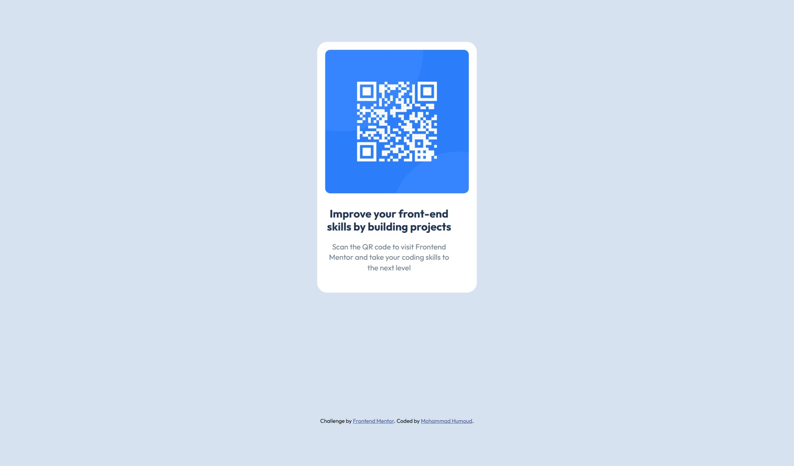

# Frontend Mentor - QR code component solution

This is a solution to the [QR code component challenge on Frontend Mentor](https://www.frontendmentor.io/challenges/qr-code-component-iux_sIO_H). Frontend Mentor challenges help you improve your coding skills by building realistic projects. 

## Table of contents

- [Overview](#overview)
  - [Screenshot](#screenshot)
  - [Links](#links)
- [My process](#my-process)
  - [Built with](#built-with)
  - [Useful resources](#useful-resources)

## Overview

This is my solution for the qr-code-component challenge on Frontend Mentor.

### Screenshot

### Links

- Solution URL: [https://github.com/mh2000hm/qr-code-component-main](https://your-solution-url.com)
- Live Site URL: [https://mh2000hm.github.io/qr-code-component-main/](https://your-live-site-url.com)

## My process

### Built with

- Semantic HTML5 markup
- CSS custom properties
- Flexbox

### Useful resources

- [Example resource 1](https://developer.mozilla.org/) - This helped me to style the page with CSS